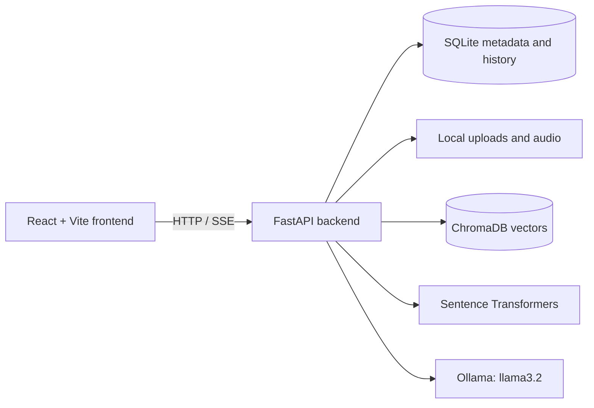

# LocalLM Notebook

LocalLM Notebook is a privacy-first, NotebookLM-inspired research workspace that runs on your computer. Create notebooks, upload PDF, DOCX, or TXT sources, ask grounded questions with citations, and generate Studio outputs without cloud AI APIs or API keys.

All model inference uses local Ollama. Uploads, embeddings, ChromaDB vectors, SQLite metadata, chat history, and optional audio remain in the local `data/` directory.

## Features

- Create, rename, search, and delete notebooks.
- Upload PDF, DOCX, and TXT sources with validation, duplicate detection, progress, and ingestion status.
- Stream grounded RAG answers with clickable citations and saved history.
- Generate summaries, study guides, flashcards, quizzes, mind maps, timelines, reports, and audio-overview scripts.
- Run locally with Ollama, sentence-transformers, SQLite, and ChromaDB.
- Use responsive desktop/tablet/mobile views and light/dark themes.

## Architecture



The browser communicates only with FastAPI. FastAPI is the only component that communicates with Ollama, the embedding model, SQLite, and ChromaDB.

## Prerequisites

- Python 3.10 or newer
- Node.js 18 or newer
- [Ollama](https://ollama.com/) installed locally
- The default model: `llama3.2`

The first embedding-model load may download model weights if not already cached. After models are downloaded, the app requires no cloud AI API.

## Quick start (Windows PowerShell)

Open three PowerShell terminals in `D:\\projects\\NoteBookLLM`.

### 1. Start Ollama

```powershell
ollama serve
```

In another terminal, install the model once if needed:

```powershell
ollama pull llama3.2
ollama list
```

### 2. Install and start the backend

```powershell
Set-Location D:\\projects\\NoteBookLLM
python -m venv .venv
.\\.venv\\Scripts\\python.exe -m pip install --upgrade pip
.\\.venv\\Scripts\\python.exe -m pip install -r .\\backend\\requirements.txt
Copy-Item .\\backend\\.env.example .\\backend\\.env
Set-Location .\\backend
..\\.venv\\Scripts\\python.exe -m uvicorn app.main:app --reload --host 127.0.0.1 --port 8000
```

If `.venv` already exists, do **not** recreate it. Start from the dependency-install command or run the Uvicorn command.

### 3. Install and start the frontend

```powershell
Set-Location D:\\projects\\NoteBookLLM\\frontend
npm install
npm run dev -- --host 127.0.0.1 --port 5173
```

Open [http://127.0.0.1:5173](http://127.0.0.1:5173). FastAPI documentation is at [http://127.0.0.1:8000/docs](http://127.0.0.1:8000/docs).

SQLite and ChromaDB are embedded local stores. There is no separate database server to start.

### One-command development launcher

After installing dependencies, start FastAPI and Vite together:

```powershell
Set-Location D:\\projects\\NoteBookLLM
.\\scripts\\dev.ps1
```

Keep `ollama serve` running separately.

## Preflight

```powershell
Set-Location D:\\projects\\NoteBookLLM
.\\.venv\\Scripts\\python.exe .\\scripts\\preflight.py
```

The preflight checks Python, Node.js, Ollama connectivity, the configured model, a generation smoke test, and local embeddings.

## Configuration

Copy `backend/.env.example` to `backend/.env`. Do not commit `.env` files.

| Variable | Default | Purpose |
| --- | --- | --- |
| `OLLAMA_BASE_URL` | `http://localhost:11434` | Local Ollama server URL |
| `OLLAMA_MODEL` | `llama3.2` | Chat and Studio model |
| `OLLAMA_NUM_CTX` | `8192` | Ollama context window |
| `EMBEDDING_MODEL` | `BAAI/bge-small-en-v1.5` | Local embedding model |
| `DATA_DIR` | `../data` | SQLite, ChromaDB, uploads, and audio |
| `MAX_UPLOAD_MB` | `25` | Per-file upload size limit |
| `MAX_FILES_PER_UPLOAD` | `10` | Files accepted in one upload |
| `RETRIEVAL_TOP_K` | `12` | Candidates retrieved before reranking |
| `RETRIEVAL_KEEP_K` | `6` | Chunks retained for answer context |
| `CORS_ORIGINS` | local Vite URLs | Allowed frontend origins |
| `VITE_API_BASE_URL` | empty | Optional frontend API base URL |

## Repository layout

```text
backend/                  FastAPI application
  app/routers/            Health, notebooks, sources, chat, and Studio APIs
  app/services/           Ingestion, extraction, retrieval, RAG, ChromaDB, Ollama, TTS
  tests/                  Backend pytest suite
frontend/                 React, TypeScript, Vite, Tailwind application
  src/components/         Dashboard, workspace panels, chat, citations, Studio renderers
  tests/e2e/              Playwright browser workflow
scripts/                  Development launcher and preflight checker
data/                     Local runtime data (ignored by Git)
```

## API summary

Interactive schemas and request examples are available at `/docs`.

| Area | Endpoints |
| --- | --- |
| Health | `GET /api/health` |
| Notebooks | `POST, GET /api/notebooks`; `PATCH, DELETE /api/notebooks/{id}` |
| Sources | `POST /api/sources/upload`; `GET /api/sources/{notebook_id}`; `DELETE /api/sources/{source_id}` |
| Chat | `POST /api/chat`; `POST /api/chat/stream`; `GET /api/chat/history/{notebook_id}`; `DELETE /api/chat/{notebook_id}` |
| Studio | `GET /api/studio/{notebook_id}`; `POST /api/studio/{summary,study-guide,flashcards,quiz,mindmap,timeline,report,audio-overview}` |
| Audio | `GET /api/studio/audio/{file}` |

`POST /api/chat/stream` sends server-sent events over a `fetch` response stream. Citation payloads are sent before token deltas, followed by a final `done` event.

## Tests and quality checks

```powershell
# Backend
Set-Location D:\\projects\\NoteBookLLM\\backend
..\\.venv\\Scripts\\python.exe -m pytest -q
..\\.venv\\Scripts\\python.exe -m ruff check .
..\\.venv\\Scripts\\python.exe -m mypy app

# Frontend
Set-Location D:\\projects\\NoteBookLLM\\frontend
npm run lint
npm run typecheck
npm test -- --run
npm run build
```

Playwright performs a real local workflow: creates a notebook, uploads a PDF, waits for ingestion, asks Ollama a question, validates citations, and captures desktop/tablet/mobile screenshots.

```powershell
Set-Location D:\\projects\\NoteBookLLM\\frontend
npm run test:e2e
```

Keep Ollama running and ensure `llama3.2` is installed for end-to-end testing.

## Troubleshooting

### Ollama is unreachable

```powershell
ollama serve
ollama list
ollama pull llama3.2
```

Then check [http://127.0.0.1:8000/api/health](http://127.0.0.1:8000/api/health).

### The first upload or question is slow

The first request loads the embedding model and Ollama may load the LLM into memory. CPU-only generation can take noticeable time for long documents and Studio outputs.

### Port 8000 or 5173 is busy

Stop the earlier backend or Vite process, then start the relevant command again. If you choose another frontend port, add that origin to `CORS_ORIGINS`.

### Reset local notebooks and vectors

Stop the application, then remove only the project runtime data directory:

```powershell
Remove-Item -LiteralPath D:\\projects\\NoteBookLLM\\data -Recurse -Force
```

This permanently deletes uploads, notebook metadata, chat history, ChromaDB vectors, and generated audio.

## Known limitations

- Retrieval quality depends on the selected local model and source-text quality.
- `llama3.2` has a limited context window; large notebooks use retrieved chunks and map-reduce Studio generation rather than the full corpus at once.
- DOCX documents do not have reliable page numbers, so citations use document sections where available.
- Scanned PDFs without extractable text require OCR before indexing.
- Audio Overview always produces a script; audio playback needs a supported local TTS engine.

## Privacy

No OpenAI, Gemini, Anthropic, or paid cloud AI API is used. Secure your computer and local `data/` directory according to your requirements.

